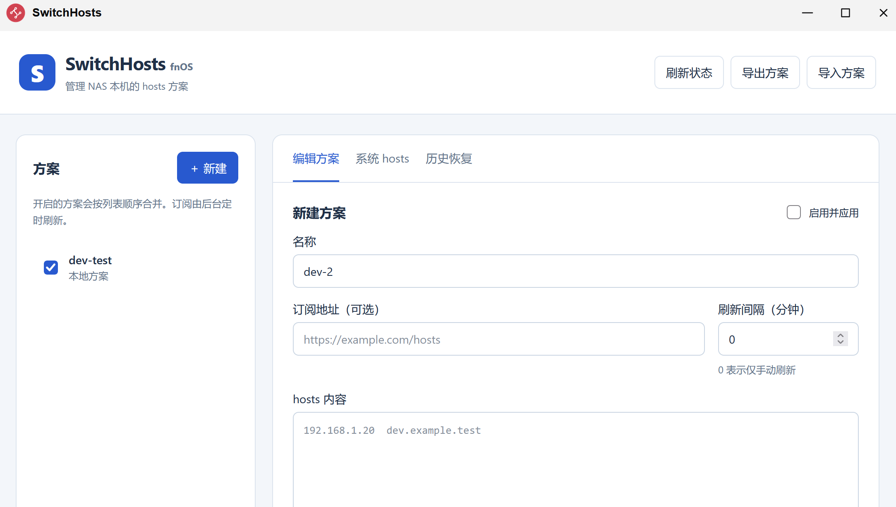

# FN-SwitchHosts

面向飞牛 NAS（fnOS）的 hosts 管理工具，通过浏览器管理 NAS 本机的 `/etc/hosts`，支持方案切换、远程订阅、方案导入导出和历史恢复。

**本项目基于 [oldj/SwitchHosts](https://github.com/oldj/SwitchHosts) 进行 fnOS 适配，沿用原项目的 [Apache License 2.0](LICENSE)。感谢原作者 [oldj](https://github.com/oldj) 及所有上游贡献者。**

## 项目来源

[SwitchHosts](https://github.com/oldj/SwitchHosts) 是原作者 oldj 及社区共同开发的开源 hosts 管理工具，官方网站为 [switchhosts.app](https://switchhosts.app)。FN-SwitchHosts 在上游代码基础上增加了飞牛 NAS 所需的后台服务、浏览器管理界面及 FPK 打包与启停脚本，并复用原项目的 hosts 文本处理与管理段合并逻辑。

FN-SwitchHosts 是本仓库维护的 fnOS 适配版本。仓库中保留了原项目的桌面端代码；飞牛版实现位于 [`fnos/`](fnos/)，功能与数据格式以飞牛版说明为准。

适配工作保留原项目的版权、许可证和相关署名声明，原项目的权利归属保持不变。

## 应用截图



## 主要功能

- **方案管理**：新建、编辑、删除本地 hosts 方案，支持同时启用多个方案。
- **远程订阅**：支持 HTTP(S) 订阅、手动刷新和定时刷新，关闭网页后仍由后台执行。
- **保留现有内容**：通过追加管理段应用方案，保留系统 hosts 中管理段之外的内容。
- **导入与导出**：使用 JSON 文件备份、迁移飞牛版方案。
- **历史恢复**：保存完整 hosts 快照，支持恢复历史内容；恢复后暂停全部方案。
- **冲突处理**：检测外部 hosts 修改，并保留中断写入的恢复记录。
- **fnOS 集成**：提供原生 FPK 安装包，通过统一网关访问，使用 NAS 管理员身份校验。

应用修改的是 **NAS 本机** 的 hosts，不会自动修改 Docker 容器或局域网其他设备的域名解析。

## 安装与使用

当前为开发预览版本，主要面向 x86_64 飞牛设备；其他架构仍需验证。

1. 准备与 NAS 架构兼容的 `FN-SwitchHosts.fpk` 安装包，构建方法见下文。
2. 在 fnOS 应用中心使用手动安装功能安装该 FPK。
3. 以管理员身份打开 **FN-SwitchHosts**。
4. 新建本地方案或填写订阅地址，保存并启用后应用到 NAS 本机 hosts。

首次启用前建议备份现有 `/etc/hosts`。卸载应用不会自动恢复系统 hosts；如需回退，请先在应用内恢复所需快照，再卸载。

从旧预览包升级时，应用标识仍为 `switchhosts`，可沿用已有方案和历史数据。应用数据保存在 `${TRIM_PKGVAR}/data`；页面中的“导出方案”只导出方案数据，不包含完整历史和恢复记录。

## 与桌面版的差异

飞牛版提供独立的 Web 界面与 Rust 后台服务。目前未移植桌面版的树形分组、回收站、代理设置、去重选项等全部功能。

方案导入导出采用飞牛版 schema 1 格式，暂不兼容桌面版完整备份。不要直接将桌面版备份作为飞牛版方案导入。

## 开发与构建

飞牛版需要 Rust >= 1.90，前端使用原生 HTML/CSS/JavaScript，无需安装桌面项目的 Node 依赖。FPK 需在 Linux 或 WSL 环境中构建，并准备飞牛官方的 [`fnpack`](https://developer.fnnas.com/docs/cli/fnpack/)。

从仓库根目录执行：

```bash
# 默认构建 x86_64 GNU Linux 安装包
bash fnos/scripts/build.sh
```

推荐的 x86_64 静态构建方式如下，需要预先安装 `musl-gcc`：

```bash
rustup target add x86_64-unknown-linux-musl
SWH_TARGET=x86_64-unknown-linux-musl bash fnos/scripts/build.sh
```

静态包输出路径为 `dist/fnos/x86_64-unknown-linux-musl/FN-SwitchHosts.fpk`。GNU 构建依赖构建环境的 glibc 版本，需核对目标 NAS 的兼容性。

本地开发、验证命令、权限模型、数据恢复及常见问题见 [飞牛版开发与部署说明](fnos/README.md)。

## 许可证与致谢

FN-SwitchHosts 沿用上游 [oldj/SwitchHosts](https://github.com/oldj/SwitchHosts) 的 **Apache License, Version 2.0**，许可证全文见 [`LICENSE`](LICENSE)。本仓库保留原许可证文件及其中的原始版权声明：

```text
Copyright 2011-2025 oldj
```

原项目代码的版权归原作者及相应权利人所有，fnOS 适配与新增代码同样按 Apache-2.0 发布。使用、修改和再分发时，应遵守许可证中的版权保留、修改声明和分发要求；第三方依赖按各自许可证使用。

感谢 oldj 和 SwitchHosts 的所有贡献者提供项目基础，也感谢飞牛提供的应用开发文档。项目按许可证约定以“现状”提供，具体授权、免责及责任限制以 [`LICENSE`](LICENSE) 原文为准。
