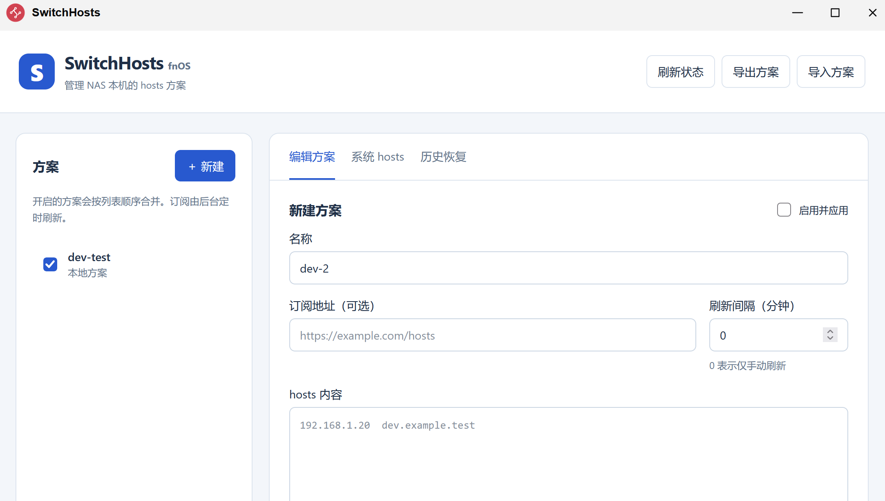

# FN-SwitchHosts（开发预览）

本项目基于 [oldj/SwitchHosts](https://github.com/oldj/SwitchHosts) 进行飞牛 NAS 适配，沿用原项目的 [Apache License 2.0](../LICENSE)，保留原作者 oldj 及原项目贡献者的版权和署名声明。fnOS 适配与新增代码同样按 Apache-2.0 发布。本版本由本仓库维护；项目介绍、来源与致谢见 [仓库首页](../README.md)。



独立于 Tauri 的 Rust 后台服务与浏览器管理界面。修改的是 NAS 本机的 `/etc/hosts`；不会自动修改 Docker 容器或局域网其他设备的解析。

0.1.3 起显示名称为 FN-SwitchHosts。保留原有 `switchhosts` 应用标识、包用户、网关路径和数据格式，可覆盖升级已有预览包并沿用方案与历史记录。

## 已实现

- 本地方案编辑、同时启用多个方案、追加段写入和删除。
- HTTP(S) 订阅、手动刷新、定时刷新；关闭网页仍由后台完成下载、合并及应用。
- 完整 hosts 快照、恢复及方案 JSON 导入导出。
- 写入前持久化恢复记录、启动时核对中断操作、外部修改冲突处理。
- 管理员鉴权、普通用户 Web 服务、仅能操作固定 `/etc/hosts` 的特权写入进程。
- fnOS 原生 FPK 打包目录、统一网关入口及生命周期脚本。

这是独立的首版界面。暂未移植桌面版的树形分组、回收站、代理设置、去重选项及完整桌面备份兼容。导入导出目前使用本 NAS 版本的 schema 1 格式；不会把桌面版备份误当作兼容文件。

## 本地开发

需要 Rust >= 1.90。前端使用原生 HTML/CSS/JavaScript，无需安装桌面项目的 Node 依赖。仅操作明确指定、已经存在的测试文件，不会默认回落到系统 hosts。

PowerShell，从仓库根目录执行：

```powershell
New-Item -ItemType Directory -Force test/tmp/fnos-dev | Out-Null
Set-Content test/tmp/fnos-dev/hosts "127.0.0.1 localhost" -Encoding utf8
$env:SWH_DEV_TOKEN = 'replace-with-a-random-token-of-at-least-32-characters'
cargo run --manifest-path fnos/server/Cargo.toml -- --development --data-dir test/tmp/fnos-dev/data --hosts-file test/tmp/fnos-dev/hosts --listen 127.0.0.1:50761
```

打开 `http://127.0.0.1:50761/app/switchhosts/`，填写该开发令牌。令牌仅保存在当前浏览器标签页的 sessionStorage 中。开发服务只允许监听回环地址，并拒绝直接指定常见系统 hosts 路径。

Linux 的启动参数相同；使用 `export SWH_DEV_TOKEN=...` 设置令牌，并提前创建测试文件。

## 构建与打包

1. 使用目标 fnOS 兼容的 Linux 构建环境安装 Rust、C/C++ 编译工具及 `readelf`。Windows 可通过 WSL 构建。
2. 从飞牛官方获取 `fnpack`，执行 `fnpack --help` 确认可用。
3. 从仓库根目录执行：

```bash
bash fnos/scripts/build.sh
```

默认编译 `x86_64-unknown-linux-gnu`，输出位于 `dist/fnos/x86_64-unknown-linux-gnu/`。构建脚本拒绝将 Windows 可执行文件或架构不符的 ELF 打包。可通过 `SWH_TARGET` 指定受支持的 GNU/musl Linux 目标，交叉编译工具链需自行准备。ARM 目标尚需真机验证。

已编译 Linux 服务时，可跳过编译：

```bash
SWH_BINARY=/absolute/path/switchhosts-fnos FNPACK=/absolute/path/fnpack bash fnos/scripts/build.sh
```

GNU 目标的最低 glibc 版本取决于构建机。正式发布建议在与目标 NAS 相同或更旧的发行版上构建，或准备 musl 交叉编译环境；不要直接假设新 Ubuntu 产物兼容所有 fnOS。CI 使用 Ubuntu 22.04 验证与构建 x86_64 服务。

推荐的 x86_64 静态构建（需要 `musl-gcc`）：

```bash
rustup target add x86_64-unknown-linux-musl
SWH_TARGET=x86_64-unknown-linux-musl bash fnos/scripts/build.sh
```

本次开发已生成并通过隔离生产进程测试的静态预览包位于 `dist/fnos/x86_64-unknown-linux-musl/FN-SwitchHosts.fpk`，不依赖目标 NAS 的 glibc。动态 GNU 预览包要求 glibc >= 2.38，优先使用静态包。静态包仍需目标 NAS 上的系统 CA 证书来验证 HTTPS 订阅。

## fnOS 部署模型

```text
fnOS 统一网关（NAS 登录态、管理员 Header）
    → root 所有的 app.sock（0600）
    → Web / 后台调度进程（降权为 switchhosts 包用户）
    → writer.sock（0600，仅包用户可连接，另校验内核对端 UID）
    → root 写入进程（固定 /etc/hosts；不接受任意路径或 shell）
```

- `config/privilege` 使用 root 仅用于生命周期准备和固定路径写入进程；Web 进程绑定网关 Socket 后，在创建多线程运行时前清除附加用户组并降权。
- 网关 Socket 父目录必须属于 root 且不可由普通用户写入。当前默认要求 fnOS 网关代理以 root 身份连接该 Socket。若目标版本使用其他网关服务身份，需要根据真机核实的 UID 调整 Socket 所有者或受限组；不能改成全员可写，也不能把管理员 Header 校验直接暴露到 TCP。
- 0.1.1 起，启动脚本自动将 `${TRIM_APPDEST}`（即应用 `target` 目录）本身设为 `root:root` 并移除组/其他用户写权限，兼容 fnOS 以包用户所有者安装目录的情况；不递归修改内容，`${TRIM_PKGVAR}/data` 仍属于包用户。网关 Socket 按官方规范保留在 `${TRIM_APPDEST}/app.sock`。
- 应用入口仅向管理员展示，API 仍独立验证 `X-Trim-Isadmin` 与 `X-Trim-Userid`。
- 本机没有公开 HTTP 端口。统一网关前缀为 `/app/switchhosts`。
- 应用数据保存在 `${TRIM_PKGVAR}/data`；运行 PID、日志和写入 Socket 位于 `/run/switchhosts-fnos`。
- `cmd/main` 对启停串行加锁，并核对进程可执行路径与启动时间，防止陈旧 PID 导致误杀。
- 停止或卸载不会擅自更改当前系统 hosts。需要回退时，先在界面恢复快照，再卸载。应用数据是否保留还取决于 fnOS 卸载选项，建议先导出方案。

## 写入和恢复语义

每次应用按以下顺序执行：读取当前 hosts → 写入并同步 `pending.json` → 写入进程检查预期内容并写入 → 同步方案与历史 → 删除恢复记录。

断电、响应丢失或状态持久化失败后，恢复记录会阻止进一步修改。重新核对时，如果文件等于预期新内容则完成提交；等于旧内容则结束未生效操作；不等于两者时，需要管理员选择保留外部文件并暂停所有方案。

hosts 写入保持原文件 inode 与权限，并在报告普通写入错误时尝试补偿。原地写入仍可能在进程被强制终止或断电时留下部分内容；恢复记录保留旧、新快照，界面会拒绝自动覆盖无法识别的文件。首次启用前，应另行保存系统 hosts 原始备份。

仅支持 UTF-8 NAS hosts。订阅必须使用 HTTP(S)、不含 URL 用户名密码，每条最多 4 MiB；合计方案/系统 hosts 最多 16 MiB。历史最多 100 条且合计最多 64 MiB。订阅失败保留缓存，并遵守刷新间隔。恢复完整快照会暂停所有方案，避免下一次订阅更新立即覆盖恢复结果。

## 验证

```bash
cargo fmt --manifest-path fnos/server/Cargo.toml --check
cargo clippy --locked --manifest-path fnos/server/Cargo.toml --all-targets -- -D warnings
cargo test --locked --manifest-path fnos/server/Cargo.toml
```

测试覆盖追加段兼容夹具、权限校验、并发版本冲突、订阅自动应用/失败缓存、历史恢复、中断提交恢复、外部 hosts 冲突及文件锁。

在可丢弃的 Linux 测试环境中，以 root 执行生产进程冒烟测试：

```bash
bash fnos/scripts/smoke-linux.sh /absolute/path/switchhosts-fnos
```

脚本建立私有 mount namespace，仅在其中把临时文件绑定到 `/etc/hosts`；不会直接写入测试环境原有的 hosts。若环境禁止 mount namespace，测试会失败退出。

冒烟测试使用实际 `cmd/main` 启停脚本，从包用户所有、权限 `0775` 的安装目录开始，验证目录权限修复、Socket 限制、进程降权、hosts 应用及停止后重启；同时在私有命名空间挂载临时 `/run`，隔离已有服务的运行目录。

## 旧预览包启动报错

若 `web.log` 包含 `socket parent must be a root-owned directory without group/other write permission`，说明网关 Socket 所在的应用 `target` 目录不符合权限要求。升级安装 0.1.1 或更新的预览包会在启动时自动修复。也可先在应用中心停止 FN-SwitchHosts，再通过 NAS root 终端执行：

```bash
target_dir="$(readlink -f /var/apps/switchhosts/target)"
test -d "$target_dir" && chown root:root -- "$target_dir" && chmod go-w -- "$target_dir"
stat -c '%U:%G %a %n' "$target_dir"
```

然后在应用中心重新启动。只修改 `target` 目录本身，不要递归修改整个应用或数据目录，也不要放宽 Socket 权限。

发布前仍需 fnOS 真机验收：FPK 安装/升级/卸载、网关进程身份、应用包目录权限、普通用户访问拒绝、NAS 重启后的订阅恢复、网络配置或系统升级对 hosts 的重写行为，以及目标架构和 glibc 兼容性。未通过这些验收前不应宣称正式支持某个 fnOS 版本。

官方文档：[应用框架](https://developer.fnnas.com/docs/core-concepts/framework/)、[应用权限](https://developer.fnnas.com/docs/core-concepts/privilege/)、[统一网关](https://developer.fnnas.com/docs/core-concepts/gateway-registration/)、[fnpack](https://developer.fnnas.com/docs/cli/fnpack/)。
